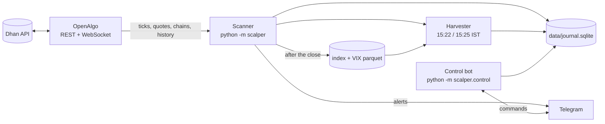

# TradeAnalyse: NIFTY / SENSEX options research and alert scanner

Research, backtesting and a live **alert-only** scanner for Indian index options (NIFTY on NFO, SENSEX on BFO),
built on [OpenAlgo](https://github.com/marketcalls/openalgo) with Dhan as the broker. The scanner never places orders.

> **Bottom line of 5 years of tests.** Almost every idea tested here has **no edge after realistic costs**.
> One rule set survived out-of-sample testing: the **Weekend VRP Harvester**. It runs live as a **paper** strategy:
> it sends Telegram alerts and keeps a journal. Treat it as a forward test, not as proven income.

---

## Contents
1. [How it fits together](#1-how-it-fits-together)
2. [Repository layout](#2-repository-layout)
3. [Quick start on Windows](#3-quick-start-on-windows)
4. [The Weekend VRP Harvester](#4-the-weekend-vrp-harvester)
5. [Telegram control](#5-telegram-control)
6. [The expiry-day scanner (S1 / S2 / S3)](#6-the-expiry-day-scanner-s1--s2--s3)
7. [Market data](#7-market-data)
8. [Research and backtesting](#8-research-and-backtesting)
9. [Day-trader-skill evaluation and workspace skills](#9-day-trader-skill-evaluation-and-workspace-skills)
10. [Analysis of your own trades](#10-analysis-of-your-own-trades)
11. [Automation on Windows](#11-automation-on-windows)
12. [Deployment on an Oracle Cloud VPS](#12-deployment-on-an-oracle-cloud-vps)
13. [Daily routine](#13-daily-routine)
14. [Configuration reference](#14-configuration-reference)
15. [Tests](#15-tests)
16. [Troubleshooting](#16-troubleshooting)
17. [Options flow dashboard (JARVIS)](#17-options-flow-dashboard-jarvis)
18. [Disclaimer](#18-disclaimer)

---

## 1. How it fits together



| Component | What it does |
|---|---|
| **OpenAlgo** (`openalgo-main/`) | Broker gateway: holds the Dhan login, serves REST (quotes, option chains, expiries, history, holidays) and a WebSocket tick feed. Kept unmodified. |
| **Scanner** (`python -m scalper`) | Long-running process. Sleeps outside market hours, wakes at 08:45 IST and waits for the broker login. Then it streams ticks, classifies the market regime, runs the strategy detectors, runs the harvester jobs and journals everything. After the close it tops up the index/VIX history. |
| **Harvester** (`scalper/harvest.py`) | The one surviving strategy. Runs inside the scanner: entry check at 15:22 IST, marks and expiry closes at 15:25 IST. |
| **Control bot** (`python -m scalper.control`) | Its own Telegram bot for `/status`, `/report`, `/check`, `/pause`, `/resume`, `/logs`, `/login`, `/restart`. |
| **Research** (`scalper/research*.py`, `vrp_harvest.py`, `backtest.py`, ...) | Offline tests on 5 years of downloaded Dhan data. |

---

## 2. Repository layout

| Path | Contents |
|---|---|
| `scalper/` | All Python code (package; `python -m scalper` = the scanner) |
| `scalper/run.py` | Scanner entry point: live loop, `--check`, `--sim`, `--replay`, `--history` |
| `scalper/engine.py`, `regime.py`, `setups.py`, `state.py`, `bars.py` | Live engine, market regimes, S1/S2/S3 detectors |
| `scalper/harvest.py` | Weekend VRP Harvester, live paper job and CLI (`--report`, `--check-now`) |
| `scalper/control.py` | Telegram control bot |
| `scalper/notify.py` | Alert delivery (own Telegram bot, or OpenAlgo's bot as fallback) |
| `scalper/index_update.py` | Daily top-up of NIFTY / SENSEX / INDIAVIX 1-minute history through OpenAlgo |
| `scalper/flow/` | Options flow dashboard engine: analytics (`model.py`), live state (`engine.py`), live/replay sources, web server |
| `web/flow/` | Dashboard page (canvas HUD, no build step) |
| `scalper/universe.py` | Thin OpenAlgo REST wrapper (`Rest`) and option-chain parsing |
| `scalper/feed.py` | Own WebSocket client (the SDK's depth callback drops OI/volume) |
| `scalper/store.py` | Journal (SQLite), tick recorder, heartbeat, pause flag |
| `scalper/execution.py` | Realistic fills: latency, bid/ask, slippage, Indian F&O charges |
| `scalper/backtest.py` | Replays downloaded sessions through the scanner and trades every alert |
| `scalper/research.py` | 1-minute expiry-day studies (buy and sell side) |
| `scalper/research_multi.py`, `research_runs.py` | Daily snapshot panel and positional studies |
| `scalper/vrp_harvest.py` | Research for the Weekend VRP Harvester |
| `scalper/skill_tests.py` | Day-trader-skill rules tested on Indian index data |
| `scalper/study.py`, `greeks.py`, `history.py`, `sim.py` | S1 premise study, Black-Scholes greeks/IV, history rebuild, synthetic day |
| `tools/dhan_download.py` | 5-year Dhan downloader (index, VIX, expired option chains) |
| `tools/audit_data.py`, `dhan_probe.py` | Data audit; single raw Dhan call for debugging |
| `tools/*.ps1` | Windows scheduled tasks (OpenAlgo, scanner, data update) |
| `deploy/vps/` | Linux server setup script and systemd units |
| `config/dhan.yaml` | All scanner / harvester settings |
| `env/dhan.env` | Secrets (API key, Telegram token). **Never commit or share.** Template: `env/dhan.env.example` |
| `.github/skills/` | Workspace skills for Copilot: India strategy test, harvest operations, event check |
| `vendor/day-trader-skill/` | Third-party skill pack (MIT), kept for reference only |
| `tests/` | Unit tests (`pytest tests`) |
| `data/market/` | Downloaded data (index/VIX parquet, option chains, audit) |
| `data/research/`, `data/backtest/` | Study outputs |
| `data/journal.sqlite` | Live journal: alerts, regimes, outcomes, harvest checks / positions / marks |
| `data/ticks/`, `data/logs/`, `data/state/` | Recorded live ticks, logs, scanner heartbeat + pause flag |
| `analyse.py`, `expiry_edge.py` | Analysis of your own broker P&L reports (Zerodha, Dhan, Kotak) |

---

## 3. Quick start on Windows

### Prerequisites
- Python 3.12+ (the PC uses 3.14), PowerShell 7 (`pwsh`).
- A Dhan account with API access (DhanHQ app: API key + secret, redirect URL registered).
- On the office network: set `HTTPS_PROXY` / `HTTP_PROXY` (e.g. `http://wss.sebank.se:80`), or Dhan calls time out (WinError 10060).

### 1. OpenAlgo (one time)
```powershell
cd openalgo-main
# venv already exists in openalgo-main\.venv; .env holds BROKER_API_KEY='client_id:::api_key' and the secret
.\.venv\Scripts\python.exe app.py        # serves http://127.0.0.1:5001, WebSocket ws://127.0.0.1:8765
```
Open http://127.0.0.1:5001, sign in, connect Dhan, then copy the **API key** from the API Key page.

### 2. Scanner environment
```powershell
cd C:\solution\python\tradeanalyse
python -m venv .venv
.venv\Scripts\python.exe -m pip install -r requirements.txt
Copy-Item env\dhan.env.example env\dhan.env    # paste OPENALGO_API_KEY (+ Telegram values, see section 5)
```

### 3. Check the connection
```powershell
$env:NO_PROXY = "127.0.0.1,localhost"
.venv\Scripts\python.exe -m scalper --check --env-file env\dhan.env
```
`--check` tests the broker session, OpenAlgo mode, expiries and option chain, WebSocket login, live ticks and Telegram.

### 4. Run
```powershell
.venv\Scripts\python.exe -m scalper --env-file env\dhan.env                  # live (sleeps outside hours)
.venv\Scripts\python.exe -m scalper.harvest --check-now --env-file env\dhan.env   # harvester dry run, any time
.venv\Scripts\python.exe -m scalper.harvest --report                         # what it collected / triggered
```
To run all of this unattended every day, see [section 11](#11-automation-on-windows) (Windows) or [section 12](#12-deployment-on-an-oracle-cloud-vps) (server).

---

## 4. The Weekend VRP Harvester

### Idea
Index options are usually priced for more movement than actually happens; that gap is the *volatility risk premium* (VRP). The
premium is richest when India VIX is above its normal level. It is also richest over weekends and holidays, because
options lose time value on calendar days the market is closed. The harvester sells that premium about four
sessions before the weekly expiry, so the holding period spans a weekend. Wings bought far out cap the loss.

### Rules (pre-registered, implemented exactly as tested)
| Step | Rule |
|---|---|
| When | Every trading day at **15:22 IST**, per index (NIFTY, SENSEX) |
| Calendar | Next weekly expiry after today. Exactly **4 sessions** left after today, counting NSE/BSE holidays from OpenAlgo's market calendar (`TRADING_HOLIDAY` rows with NFO/BFO closed). Never on an exchange holiday or on an expiry day. |
| Volatility filter | Live India VIX **≥ median of its previous 250 daily 15:25 values** (needs ≥ 120 days of history, at most 10 days old) |
| Position | **Sell** ATM call + ATM put (ATM = spot rounded to the strike step). **Buy** wings at `clamp(round(2 × straddle / step), 4, 10)` strikes out. In practice that is usually 10 strikes (NIFTY 500 pts, SENSEX 1,000 pts). |
| Prices | Sells at the **bid**, buys at the **ask** (the journal uses real touch prices) |
| Max loss | `wing width − credit` per unit; capped by the wings |
| Size | `lots = floor(equity × risk_pct / (max loss per unit × lot size))`, default 1% of paper equity. 0 lots → **shadow** position (tracked in R only). |
| Exit | Hold to **expiry day 15:25 IST**: shorts bought back at the ask, wings sold at the bid. **No stop.** The tested rule holds to expiry. |
| Charges | Brokerage ₹20/order × 8, STT, exchange fees, SEBI, stamp, GST (`execution.charges`) |

### Risk gates (ported from the day-trader-skill trader-risk / trader-budget skills)
Any failing gate blocks the entry, and the reason is journalled.

| Gate | Default |
|---|---|
| One open position per index | always |
| Total open max loss ≤ `max_open_risk_pct` of equity | 2.5% (NIFTY and SENSEX positions overlap) |
| Pause new entries after a paper drawdown of | 6% (backtest worst ≈ 3% at 1% risk) |
| 4-leg bid/ask spread cost ≤ % of the credit | 5% |
| Manual pause from Telegram (`/pause`) | off |

Events in the holding window (`harvest.events`, e.g. RBI policy, Budget) are **listed in the alert but do not block it**.
The backtest did not filter on events, so skipping them would be an untested rule.

### Backtest evidence (`python -m scalper.vrp_harvest`, saved in `data/research/vrp_harvest.txt`)
Per-trade return in units of max loss (R). Train = before 2024-07-01, test = after.

| Entry (sessions before expiry) | VIX filter | Test avg R (t, n) | Train avg R (n) |
|---|---|---|---|
| 1 | on | −0.03 (−0.49, 131) | +0.05 (53) |
| 2 | on | +0.03 (0.40, 130) | −0.07 (51) |
| 3 | on | +0.03 (0.45, 130) | +0.06 (49) |
| **4** | **on** | **+0.31 (2.93, 86)** | **+0.10 (38)** |
| 4 | off | +0.04 (0.59, 174) | +0.03 (103) |
| 4, stress (2× spreads, 2 ticks slip) | on | +0.29 (2.81, 86) | +0.09 (38) |

- 9 of 9 neighbouring settings (wing multiple, VIX quantile) stayed positive, and both indices were positive.
- ₹5 lakh at 2% risk per trade, whole lots: ₹6.21 lakh, CAGR 5.0%, max drawdown 4.7% (only trades that fit one lot).
  An earlier ₹10 lakh run (more NIFTY trades fit) ended at ₹15.7 lakh, CAGR 10.6%, max drawdown 5.7%.
- **Caveats:** the train period alone is not significant, and the edge is concentrated after mid-2024. Only the
  4-session / VIX-on cell works; nearby entry days do not. This can be a real weekend effect, or luck. That is why it runs as paper first.

### What runs live, and what is recorded
| Time (IST) | Job |
|---|---|
| 15:22 | Entry check per index → journal row in `harvest_checks` (decision + reason) → on entry: `harvest_positions` row + Telegram `[HARVEST PAPER]` alert listing the 4 legs, size and max loss |
| 15:25 | Every open position: mark-to-market at mid (`harvest_marks`); on expiry day: closed at the touch, P&L after charges booked |
| next run | A position whose expiry passed while the scanner was off is settled at intrinsic value from the stored 15:25 index price |
| after 15:31 | NIFTY / SENSEX / INDIAVIX 1-minute bars of the day are appended to `data/market/index` |

Journal tables (in `data/journal.sqlite`):
- `harvest_checks(day, time, underlying, decision, reason, details)`. `decision` is `entry`, `skip` or `error`. `details` is JSON with the expiry, sessions left, VIX, median and plan.
- `harvest_positions(id, underlying, exchange, opened, expiry, status, lots, lot_size, legs, credit, width, max_loss_unit, max_loss_rs, vix, vix_median, spot, closed, exit_value, charges_rs, pnl_unit, pnl_r, pnl_rs, note)`.
- `harvest_marks(day, position_id, value, pnl_unit, pnl_r, pnl_rs)`.

### Commands
```powershell
.venv\Scripts\python.exe -m scalper.harvest --report                                   # positions, P&L, every check and reason counts
.venv\Scripts\python.exe -m scalper.harvest --check-now --env-file env\dhan.env         # dry run with live quotes (nothing journalled)
.venv\Scripts\python.exe -m scalper.harvest --check-now --env-file env\dhan.env --telegram   # ... and send the dry alert
```

### Placing an alert by hand (optional; human approval, as in trader-broker)
1. Within a few minutes of the alert (before 15:30), place the **two BUY wings first**, then the two SELLs, as limit
   orders at or better than the alert prices. Product **NRML** (carried to expiry).
2. On expiry day close all four legs around 15:25, or let them settle.
3. Keep `paper: true` in the config; the journal is the record you compare against.

### Going live checklist
1. At least 8–10 closed paper trades, with results in the same ballpark as the backtest (+0.31R test period, +0.06–0.10R train).
2. Set `harvest.capital_rs` to the capital you would really use. Start at `risk_pct: 1.0` (the backtest used 2%).
   Today one NIFTY lot risks about ₹16,000, which needs about ₹16 lakh at 1%. One SENSEX lot risks about ₹6,000, which needs about ₹6 lakh.
3. Check the event window before every entry (skill `india-event-check`).

---

## 5. Telegram control

The scanner has **its own Telegram bot**, used for alerts and commands. Do not reuse OpenAlgo's bot token: two programs polling
one token make Telegram reject both (HTTP 409). Without a bot configured, alerts fall back to OpenAlgo's bot
(`notify.telegram_username`).

### Setup
1. In Telegram, talk to **@BotFather** → `/newbot` → copy the token into `env/dhan.env` as `TELEGRAM_BOT_TOKEN=...`.
2. Send any message to your new bot, then find your chat id:
   ```powershell
   .venv\Scripts\python.exe -m scalper.control --whoami --env-file env\dhan.env
   ```
   Put it in `env/dhan.env` as `TELEGRAM_CHAT_ID=...` (several ids comma-separated).
3. Start the bot (on the server it runs as a service):
   ```powershell
   .venv\Scripts\python.exe -m scalper.control --env-file env\dhan.env
   ```

### Commands
| Command | Reply |
|---|---|
| `/status` | Scanner alive? (heartbeat + phase), broker logged in?, OpenAlgo mode, harvest paused?, paper equity, open positions with last mark, today's harvest decisions |
| `/report` | The harvest journal report (positions, P&L, last checks, reason counts) |
| `/check` | Dry run of the harvest entry check with live quotes; plans arrive as separate messages |
| `/pause` / `/resume` | Stop / allow **new** harvest entries (open positions are still marked and closed) |
| `/logs [n]` | Last n lines (default 20, max 60) of today's scanner log |
| `/login` | Link and steps to log in to OpenAlgo and connect Dhan |
| `/restart scanner` / `/restart openalgo` | Restart the service (Linux server only, via a narrow sudoers rule) |
| anything else | Help |

Security:
- Only chat ids in `TELEGRAM_CHAT_ID` are answered; other chats are ignored and logged.
- Commands take no free text, so nothing from Telegram reaches a shell.
- Commands sent while the bot was down are discarded at startup, so an old `/restart` is never replayed.

---

## 6. The expiry-day scanner (S1 / S2 / S3)

The scanner streams ATM ±15 strikes (CE and PE) of the nearest weekly expiry for NIFTY and SENSEX, plus India VIX.
It re-centres when spot moves 4 strikes. Each minute it classifies the regime
(`WARMUP, NORMAL, TREND_UP/DOWN, RANGE, BREAKOUT_UP/DOWN, CHAOS`) and runs the detectors on expiry days.

| Setup | Idea | 5-year result | Status |
|---|---|---|---|
| **S1 fall-bounce** (buy) | Option that collapsed in the morning bounces | −0.15R/trade (n 1,068, t −3.8), negative in both halves | `s1.enabled: false` |
| **S2 expiry burst** (buy) | Cheap OTM option starts to rocket late on expiry day | −0.47R (plan exits) / −0.23R (50% stop) | `s2.enabled: false` |
| **S3 quiet-decay iron fly** (sell) | Sell ATM fly 11:00–13:30 when the index is quiet and the straddle decays; per-leg 50% stop; exit 15:15 | Test −0.21R with honest fills; 0 of 54 neighbours positive | `s3.paper: true` (alerts say PAPER) |

Every alert is journalled (`signals`), graded afterwards (`outcomes`), and a regime snapshot is saved each minute (`minutes`).
Live ticks are recorded to `data/ticks/<day>.jsonl.gz`.

Offline modes:
```powershell
.venv\Scripts\python.exe -m scalper --sim                              # synthetic SENSEX expiry day
.venv\Scripts\python.exe -m scalper --replay data\ticks\2026-10-29.jsonl.gz
.venv\Scripts\python.exe -m scalper --history 2026-10-29 --env-file env\dhan.env   # rebuild a past day from Dhan 1m bars
# --any-day: let expiry-day setups fire on other days;  --telegram on|off|auto;  --verbose
```

---

## 7. Market data

### Download (`tools/dhan_download.py`)
Runs with **OpenAlgo's interpreter** and reuses OpenAlgo's logged-in Dhan session, HTTP client and rate limiter. No token is copied.
```powershell
openalgo-main\.venv\Scripts\python.exe tools\dhan_download.py --user chetan --years 5 --chains all
```
| Option | Meaning |
|---|---|
| `--chains expiry\|all\|none` | Option chains for expiry days only, for every session (expiry days first, then newest first), or none |
| `--skip-options` | Index and VIX only |
| `--max-requests 40000` | Request budget per run. Dhan throttled this account (DH-904) after ~60k requests in one day. |
| `--max-rate 2` | Requests per second. 3.5/s got blocked after ~10k requests. |
| `--workers 4`, `--width 10`, `--refresh`, `--underlyings` | Parallel requests, strikes each side of ATM (max 10), re-download, subset |

- The downloader is resumable: finished years, scanned sessions and saved chains are skipped.
- Dhan's expired-options endpoint serves at most 1–2 sessions per request, so it fetches one session at a time.
- On DH-904 it backs off adaptively and pauses for 2, 5, 10 and 15 minutes.
- Don't run it during market hours: it shares the Dhan request limit with live trading.

### Layout
| Path | Contents |
|---|---|
| `data/market/index/{NIFTY,SENSEX,INDIAVIX}/YYYY.parquet` | 1-minute bars `ts` (epoch s), `open, high, low, close, volume` |
| `data/market/options/<NAME>/days.csv` | Every session with its ATM straddle; expiry calendar |
| `data/market/options/<NAME>/chain/YYYY-MM-DD.parquet` | ATM−10..ATM+10, CE and PE, OHLC, volume, OI, IV, strike, spot (nearest weekly expiry) |
| `data/market/audit.csv`, `audit.txt` | Data audit (`python tools\audit_data.py`) |

Status on 1 Nov 2026 (0.9 GB in total):
- NIFTY: 1,232 sessions with chains (2021-11-02 → 2026-10-30), 261 of them expiry days.
- SENSEX: 856 sessions (2023-05-15 → 2026-10-30), 181 of them expiry days.

### Known data problems (handled in code)
- **SENSEX chains:**
  - 2023 has wrong strikes, filler bars and no OI.
  - Jan–Mar 2024 has no OI.
  - Apr–Sep 2024 has a stale second contract.
  - Sep 2025 has duplicate contracts.

  `backtest.clean_chain` checks strikes against the real index ATM, drops no-trade bars and removes duplicates. Days need ≥ 90% ATM ±2 coverage and OI present.
- Index files contain 07:06–18:15 bars; the code keeps 09:15–15:29 IST.
- **Bad prints at bar closes**: stops are filled at the stop bar's open / last trade, never at a suspicious close.
- **Untraded strikes**: marked off the implied-volatility smile (`research_multi.Book`), validated against real prices
  (median error 0.3–1% near the money, 2–4% far out). Fly values are clamped to `[0, width]`.

### Daily top-up
Easiest: click **DATA** in the flow dashboard (top left, section 17) after 15:35 IST with OpenAlgo logged in. It runs the
index/VIX top-up below and then the chain downloader (only missing sessions, plus `days.csv`).

The scanner calls `scalper.index_update` after every session, so the harvester's VIX history stays current on any machine.
OpenAlgo's history times are shifted by the host's time zone; the shift is detected and corrected automatically.
This was checked against the stored files: 375/375 bars identical.
```powershell
.venv\Scripts\python.exe -m scalper.index_update --env-file env\dhan.env --days 30     # by hand / bootstrap (--days 400)
```

---

## 8. Research and backtesting

### Protocol (also in the `india-strategy-test` skill)
1. Write the rule before looking at results.
2. **Fill honestly**:
   - sells at the bid, buys at the ask;
   - half-spread NIFTY 0.10% / SENSEX 0.25% (minimum one tick);
   - plus 1 tick slippage and 15 s latency intraday;
   - full charges (STT/exchange-fee revision on 2024-10-01 applied by date).
3. **Train** before 2024-07-01, **test** after. Pick parameters on train only, from a plateau of good values, with small grids.
4. **Neighbours**: shift each parameter one step; a real edge stays positive.
5. **Stress test**: double spreads, more slippage, 30 s latency.
6. Keep only a rule whose test average is > 0 with t ≈ 2+ and whose neighbours are mostly positive. Start it as paper.

### Commands
```powershell
.venv\Scripts\python.exe -m scalper.backtest --days expiry            # full scanner replay; --days other|all, --any-day,
                                                                      # --set s3.wing_strikes=4, --spread-mult 2, --latency-sec 30
.venv\Scripts\python.exe -m scalper.research build                    # cache 1-minute expiry days
.venv\Scripts\python.exe -m scalper.research buy  --set k=v           # buy-side studies
.venv\Scripts\python.exe -m scalper.research sell --set k=v           # sell-side (fly / legs) studies
.venv\Scripts\python.exe -m scalper.research_multi build              # daily snapshot panel -> data/research/panel.parquet
.venv\Scripts\python.exe -m scalper.research_runs                     # positional studies
.venv\Scripts\python.exe -m scalper.vrp_harvest --capital 500000 --risk-pct 2
.venv\Scripts\python.exe -m scalper.study --sweep                     # S1 premise on the index
.venv\Scripts\python.exe -m scalper.skill_tests                       # day-trader-skill rules
```

### Results summary
| Idea | Result |
|---|---|
| S1 fall-bounce, S2 expiry burst (expiry-day buying) | Negative after costs |
| Trend pullback / breakout scalps on expiry day | Test −0.18R / −0.26R |
| Intraday momentum (first 30 min → close) | t 2.0 before mid-2024, 0.08 after. Vanished, probably with SEBI's Nov-2024 expiry rules. |
| Long straddle, OI pin, OTM lottery tickets | Lose at every entry time |
| S3 quiet-decay iron fly | Looked positive until a fill bug was fixed: test −0.21R, no neighbour positive → paper only |
| Overnight / hold-to-expiry flies, 1σ condors, long strangles | Negative or insignificant net of costs |
| Naked ATM straddle (VRP) | Small (+2–5% of premium, t < 2) with fat tails |
| **Weekend VRP Harvester** | **Test +0.31R (t 2.9), 9/9 neighbours positive → live as paper** |

Lot sizes used by date:
- NIFTY: 50 → 25 (2024-04-26) → 75 (2024-11-20) → 65 (2025-12-30).
- SENSEX: 10 → 20 (2024-11-20).

Expiry weekdays have changed several times (NIFTY Thu → Tue; SENSEX Fri → Tue → Thu), so the code always uses the real calendar.

---

## 9. Day-trader-skill evaluation and workspace skills

The [day-trader-skill](https://github.com/Jakeschincariol/day-trader-skill) pack (MIT, US stocks) was cloned to `vendor/` and
its trading rules were tested on 5 years of NIFTY/SENSEX data (`scalper/skill_tests.py` → `data/research/skill_tests.txt`):

| Skill / rule | Result on Indian indices |
|---|---|
| trader-scanner + entry + exit: 15-min opening-range breakout, stop at range mid, 1R target, flat 15:20 | Coin flip: test −0.04R (NIFTY), −0.05R (SENSEX) |
| Same with a 2R target, or the stop at the far side of the range | About zero |
| Daily setups: 20-day breakout, bull flag, oversold bounce | Positive in train, **negative in test** (20-day breakout t −2.0 / −2.8) |
| Reclaim of the 20-day average | NIFTY +55 bps over 5 days in test (t 1.9, n 28); weak on SENSEX → watch only |
| trader-timemachine: 2,000-run replay odds | Not predictive (correlation with the real outcome −0.03 / −0.01) |
| trader-news / analyst / pelosi | US sources (SEC filings, US Congress trades); no equivalent for Indian indices |

What was useful is the **process**, and it has been ported:
- size every position to a rupee max loss;
- hard risk gates and a drawdown pause;
- alerts that fire once;
- paper by default, with human approval for orders.

These live in the harvester and in three workspace skills (`.github/skills/`) that Copilot loads on demand:

| Skill | Use it for |
|---|---|
| `india-strategy-test` | Testing a new NIFTY/SENSEX idea on the stored data with the protocol above, plus the list of ideas already rejected |
| `india-harvest-ops` | Reports, dry runs, sizing in lots, risk gates, placing the legs by hand, going-live checklist |
| `india-event-check` | Checking RBI policy, Budget, elections, FOMC/CPI, NSE/BSE circulars in the holding window → `harvest.events` |

---

## 10. Analysis of your own trades

```powershell
.venv\Scripts\python.exe analyse.py        # all broker reports -> out/report.txt + CSVs
.venv\Scripts\python.exe expiry_edge.py    # time-of-day / expiry-day breakdown
```
| Broker | Input file | Detail |
|---|---|---|
| Zerodha | `taxpnl-*.xlsx` ("Tradewise Exits", F&O section) | Fill-level with entry/exit timestamps |
| Dhan | `dhan_tax_pnl.xlsx` / `PNL_REPORT.xls` | Per day and contract |
| Kotak | `Gain_Loss_*.xlsx` | Per contract and financial year, no dates |

Findings:
- All brokers combined: net about −₹31.6 lakh (gross −₹21.4 lakh, charges ₹10.1 lakh).
- The only positive zone was expiry day 09:15–12:30, with about 68% winners.
- Trading after 12:30 lost money, and averaging down into a bounce never worked.

These findings were the starting point for S1/S2. The systematic tests later showed that those patterns don't survive realistic fills.

---

## 11. Automation on Windows

```powershell
pwsh -File tools\install_tasks.ps1            # install / update (current user, no admin needed)
pwsh -File tools\install_tasks.ps1 -Remove    # remove all three
```
| Task | Schedule | Script |
|---|---|---|
| `TradeAnalyse-OpenAlgo` | Every 15 min; starts OpenAlgo if port 5001 is not listening | `tools/run_openalgo.ps1` |
| `TradeAnalyse-Scanner` | Every 15 min; starts the scanner if it is not running | `tools/run_scanner.ps1` |
| `TradeAnalyse-DataUpdate` | Mon–Fri 12:30 local time (after the Indian close) | `tools/run_data_update.ps1` (option chains for research) |

- Logs go to `data\logs\` (`scalper-<date>.log`, `openalgo-<date>.log`, `data-update-<date>.log`, `*-tasks.log`).
- The tasks run in your logged-on session, so they use your proxy settings.
- `task_env.ps1` sets `NO_PROXY` for localhost.
- Keep the PC awake: `powercfg /change standby-timeout-ac 0`.
- A venv `python.exe` shows up as two processes (launcher + interpreter); that is normal.

---

## 12. Deployment on an Oracle Cloud VPS

The server runs OpenAlgo (official installer: nginx + Let's Encrypt + systemd), the scanner and the control bot.
It needs no PC and is controlled from Telegram. The research data stays on the PC; the server only needs the index/VIX history.

### Step 1: Create the server
1. Sign up for Oracle Cloud. Choose **India West (Mumbai)** or **India South (Hyderabad)** as the home region. It cannot be
   changed later, and it is close to Dhan.
2. Optional: upgrade to **Pay-As-You-Go**. You still pay nothing within the Always Free limits, and idle instances are not reclaimed.
3. On the PC, create an SSH key: `ssh-keygen -t ed25519`.
4. Create an instance:
   - Image: **Canonical Ubuntu 24.04**.
   - Shape: **VM.Standard.A1.Flex**, 2 OCPU / 12 GB (Always Free, ARM).
   - Upload `~/.ssh/id_ed25519.pub`.
   - "Out of capacity" means retry later or try another availability domain.
5. **Reserve a public IP** (Networking → Reserved public IPs) and assign it to the instance's VNIC. This is your static IP.
6. In the subnet's **security list**, add ingress rules: TCP **80** and **443** from `0.0.0.0/0`. Port 22 is already open; ideally restrict it to your IP.

### Step 2: Domain
Create an A record such as `algo.yourdomain.com` pointing at the reserved IP. Any domain works, including a free DuckDNS subdomain.
Wait until `nslookup algo.yourdomain.com` returns the IP.

### Step 3: Open the server firewall
Oracle's Ubuntu image rejects everything except SSH in iptables. This is the usual reason the SSL step fails.
```bash
ssh ubuntu@<IP>
sudo apt update && sudo apt -y upgrade
sudo iptables -I INPUT 6 -m state --state NEW -p tcp --dport 80 -j ACCEPT
sudo iptables -I INPUT 6 -m state --state NEW -p tcp --dport 443 -j ACCEPT
sudo netfilter-persistent save
```

### Step 4: Install OpenAlgo
```bash
wget https://raw.githubusercontent.com/marketcalls/openalgo/main/install/install.sh
chmod +x install.sh && sudo ./install.sh        # enter the domain; answer yes to the IST timezone question
```
1. Open `https://algo.yourdomain.com`, create your user and **enable two-factor login (TOTP)**, since the site is public.
2. **Broker Configuration** → Dhan → `client_id:::api_key` and the secret.
3. In the Dhan developer console set the redirect URL to `https://algo.yourdomain.com/dhan/callback`.
   A Dhan app has one redirect URL, so the PC's OpenAlgo login stops working after this.
4. Log in to Dhan once, then copy the new **API key** from OpenAlgo.

Service name: `openalgo`. Install path: `/var/python/openalgo`. REST is served through nginx; the WebSocket is on `127.0.0.1:8765`.

### Step 5: Telegram bot
Create the scanner's bot with @BotFather (see [section 5](#5-telegram-control)) and send it a message.

### Step 6: Copy the project from the PC
```powershell
cd C:\solution\python\tradeanalyse
tar -czf ta.tgz scalper tests config deploy requirements.txt env/dhan.env.example data/market/index data/journal.sqlite
scp ta.tgz ubuntu@<IP>:~
```

### Step 7: Set up the scanner
```bash
mkdir -p ~/tradeanalyse && tar -xzf ~/ta.tgz -C ~/tradeanalyse && cd ~/tradeanalyse
bash deploy/vps/setup.sh algo.yourdomain.com
nano env/dhan.env                       # OPENALGO_API_KEY, TELEGRAM_BOT_TOKEN
.venv/bin/python -m scalper.control --whoami --env-file env/dhan.env      # -> TELEGRAM_CHAT_ID into env/dhan.env
.venv/bin/python -m scalper --check --config config/vps.yaml --env-file env/dhan.env
.venv/bin/python -m scalper.index_update --config config/vps.yaml --env-file env/dhan.env --days 10
sudo systemctl enable --now tradeanalyse-scanner tradeanalyse-control
```
`deploy/vps/setup.sh` does the following:
- installs `python3-venv`, creates `.venv` and installs `requirements.txt`;
- writes `config/vps.yaml`: a copy of `config/dhan.yaml` with `host: https://<domain>` and `ws_url: ws://127.0.0.1:8765`;
- adds `127.0.0.1 <domain>` to `/etc/hosts`, so API calls stay on the machine;
- creates `env/dhan.env` (mode 600) from the example;
- installs the systemd units `tradeanalyse-scanner` and `tradeanalyse-control` (both `Restart=always`);
- adds a sudoers rule that allows **only** `systemctl restart tradeanalyse-scanner` and `systemctl restart openalgo` (for `/restart`);
- runs the tests.

Send `/status` to the bot: you should see `Scanner: ALIVE` and `Broker: logged in`.

### Step 8: Switch off the PC version
Otherwise you get double alerts and a Telegram 409 conflict.
```powershell
pwsh -File tools\install_tasks.ps1 -Remove
Get-CimInstance Win32_Process -Filter "Name='python.exe'" | Where-Object CommandLine -match '-m scalper ' | ForEach-Object { Stop-Process -Id $_.ProcessId -Force }
```

### Server maintenance
| Task | Command |
|---|---|
| Update the code | On the PC, repeat the `tar` + `scp` from step 6 without `data/journal.sqlite`; on the server `tar -xzf ~/ta.tgz -C ~/tradeanalyse`, then `/restart scanner` and `sudo systemctl restart tradeanalyse-control` |
| Logs | `journalctl -u tradeanalyse-scanner -f`, `journalctl -u tradeanalyse-control -f`, `~/tradeanalyse/data/logs/`, or `/logs 40` |
| Back up the journal | `scp ubuntu@<IP>:~/tradeanalyse/data/journal.sqlite .` |
| Update OpenAlgo | Its own `install/update.sh` |
| Service status | `systemctl status openalgo tradeanalyse-scanner tradeanalyse-control` |

If you ever place orders through the API, register the reserved IP in Dhan's API settings first. Under SEBI's retail-algo rules,
brokers require a whitelisted static IP for order APIs; quotes and data do not need it.

---

## 13. Daily routine

The Dhan / OpenAlgo session ends at **03:00 IST** every day, and the broker login cannot be automated.

| IST | Sweden, winter (CET) | Sweden, summer (CEST) | What happens |
|---|---|---|---|
| 03:00 | 22:30 | 23:30 | Broker session expires |
| 08:45 | 04:15 | 05:15 | Scanner wakes; if not logged in it sends the login link to Telegram |
| any time before 15:15 | before ~10:45 | before ~11:45 | **You:** `/login` → open the link → sign in to OpenAlgo → connect Dhan → `/status` |
| 15:22 | 10:52 | 11:52 | Harvest entry check (alert if it triggers) |
| 15:25 | 10:55 | 11:55 | Marks; positions closed on expiry day |
| 15:31 | 11:01 | 12:01 | Session summary; index/VIX history top-up |

Expiry-day setups (S1–S3) need the login before 09:15 IST. The harvester only needs it before 15:22 IST.

---

## 14. Configuration reference

### `config/dhan.yaml` (`config/vps.yaml` on the server)
| Section | Key settings |
|---|---|
| `openalgo` | `host` (PC `http://127.0.0.1:5001`, server `https://<domain>`), `ws_url`, `api_key_env` |
| `notify` | `telegram_username` (OpenAlgo-bot fallback), `min_interval_sec` |
| `underlyings` | NIFTY (NSE_INDEX / NFO), SENSEX (BSE_INDEX / BFO), `enabled` |
| `session` | `wake 08:45`, `start 09:15`, `flatten 15:20`, `end 15:31` (IST) |
| `universe` | `strike_count 15`, re-centring, `expiry_only` (S1–S3 only on expiry days) |
| `risk` | `R` rupees per idea, used to size the S1/S2 plans |
| `regime` | Thresholds for trend / range / breakout / chaos |
| `s1`, `s2`, `s3` | Detector settings; S1/S2 disabled, S3 `paper: true` |
| `harvest` | `enabled`, `paper`, `capital_rs`, `risk_pct`, `max_open_risk_pct`, `pause_drawdown_pct`, `dte_entry`, `entry_time 15:22`, `mark_time 15:25`, `deadline 15:29`, `vix_lookback 250`, `vix_min_days`, `max_vix_age_days`, `wing_mult 2`, `min_wing 4`, `max_wing 10`, `max_spread_cost_pct`, `events` |
| `paths` | `data_dir`, `journal` |

Unknown keys are rejected at startup, so typos fail loudly.

### `env/dhan.env`
| Variable | Purpose |
|---|---|
| `OPENALGO_API_KEY` | OpenAlgo API key (API Key page of *that* OpenAlgo instance) |
| `TELEGRAM_BOT_TOKEN` | The scanner's own bot (@BotFather) |
| `TELEGRAM_CHAT_ID` | Chat ids allowed to receive alerts and send commands |

Shell environment on the office PC: `HTTPS_PROXY` / `HTTP_PROXY` for Dhan, and `NO_PROXY=127.0.0.1,localhost` for OpenAlgo.

---

## 15. Tests
```powershell
.venv\Scripts\python.exe -m pytest -q tests      # 44 tests
```
Run `pytest tests`, not bare `pytest`: a bare run also collects `openalgo-main/` and fails on its missing dependencies.

The tests cover:
- the engine, setups and regimes;
- execution and charges;
- backtest grading;
- the harvester: session counting with holidays, the VIX median, wings, sizing, gates, and the full entry → mark → expiry close cycle, including a missed expiry and never entering on an expiry day;
- the control bot;
- the index top-up time correction.

---

## 16. Troubleshooting

| Symptom | Cause / fix |
|---|---|
| Dhan calls time out (WinError 10060) | Office proxy: set `HTTPS_PROXY` / `HTTP_PROXY` |
| Calls to 127.0.0.1 fail or go through the proxy | Set `NO_PROXY=127.0.0.1,localhost` (the task scripts do this) |
| `DH-904 Too many requests` | Download limit: `--max-rate 2`, `--max-requests 40000`, resume after midnight IST, not during market hours |
| `/status`: "Broker: NOT logged in" | Daily login needed: `/login` |
| `/status`: "NOT RESPONDING" | Scanner crashed or hung: `/restart scanner`, then `/logs 40` |
| Harvester skips with "VIX history ends ..." | History older than 10 days: `python -m scalper.index_update --days 30` |
| Telegram `409 Conflict` | Two programs poll the same bot token (PC and server, or OpenAlgo's bot): use one bot per program |
| No Telegram alerts | Check `TELEGRAM_BOT_TOKEN` / `TELEGRAM_CHAT_ID`, then run `python -m scalper --check` |
| Let's Encrypt fails on Oracle | iptables rules (step 3), the security list (ports 80/443), and DNS pointing at the reserved IP |
| "Out of capacity" creating the A1 instance | Retry later or try another availability domain; Pay-As-You-Go helps |
| History bars appear 4.5 h off | OpenAlgo converts with the host time zone; `history.session_shift_ms` corrects it automatically |
| Two `python.exe` for one scanner (Windows) | venv launcher + interpreter; normal |
| A backtest looks too good | Check fills at bar closes (bad prints), untraded strikes, values outside `[0, width]`, and train vs test |

---

## 17. Options flow dashboard (JARVIS)

A full-screen, real-time HUD for NIFTY and SENSEX options in the browser, running locally on your PC.
The Python engine (`scalper/flow/`) computes the analytics; the page (`web/flow/`, plain canvas, no libraries) draws
them at 60 fps, with values easing toward each 10 Hz update so nothing jumps.

```powershell
.venv\Scripts\python.exe -m scalper.flow --open                                    # replay the latest stored day
.venv\Scripts\python.exe -m scalper.flow --replay 2026-10-29 --speed 120 --start 11:30
.venv\Scripts\python.exe -m scalper.flow --live --env-file env\dhan.env --open      # live: OpenAlgo running + Dhan connected
```
Then open http://127.0.0.1:8787. It only listens on 127.0.0.1.

### What it streams (live)
About 200 subscriptions in total:
- NIFTY and SENSEX: current and next weekly expiry, ATM ±12 strikes, CE and PE. Each gets Dhan's full packet: LTP, volume, OI and a 5-level order book.
- NIFTY current expiry: **20-level order book** on the 49 contracts nearest the money (Dhan offers 20 levels on NFO only, at most 50 instruments; the 50th slot is the NIFTY future).
- **Near-month NIFTY and SENSEX futures**: every packet with a 5-level book, plus a 20-level book for NIFTY (BSE offers 5 levels only, and SENSEX futures trade thinly, so NIFTY futures lead).
- Both indices and India VIX.

The strike window re-centres every minute when spot drifts.

When started after the open, the live dashboard loads today's 1-minute close, OI and volume for every strike in the
background (about 1–2 minutes; progress is shown under LIVE). After that:
- OI change is measured from 09:15;
- the heatmap starts at the open;
- the straddle-decay panel anchors at 09:20.

### Panels
| Panel | Shows |
|---|---|
| Top HUD | Spot, synthetic forward + basis, VIX, PCR (OI / volume), max pain, gamma flip, net GEX (pinning / trending), IV vs realised vol, straddle, time to expiry (0DTE flagged) |
| **DATA** button (top left) | One click tops up everything the research, scanner and harvester read: index & VIX bars (`scalper.index_update`), then option chains and the expiry calendar (`tools/dhan_download.py` with OpenAlgo's interpreter, missing sessions only), then Order Flow's NSE/BSE archive (`npm run fetch:nse`, optional: a failure there is reported but does not fail the update). Amber = stored data is behind the last closed session; green = current; hover for dates and progress. Chains are skipped 09:00–15:35 IST (they share Dhan's request limit with live trading). Needs OpenAlgo running with Dhan connected and `notify.telegram_username` set to your OpenAlgo login. Progress and the result go to the JARVIS feed; the full output to `data/logs/update-<day>.log` |
| **ORDER FLOW ↗** button (top) | Opens the whole-market board ([Order Flow](#order-flow-whole-market-board) on 127.0.0.1:8790). Green when it answers; hover for today's breadth |
| **Market read** (top right) | One rule-based verdict with the numbers behind it. Bias from three votes:<ul><li>which writers lead near the money in the last 15 minutes</li><li>call vs put aggression over the last 5 minutes</li><li>put vs call OI added since the open</li></ul>Each vote is −1, 0 or +1, giving BULLISH / BEARISH TILT, LEANING, RANGE / PIN or MIXED. Also shown: support and resistance (largest put / call OI, and whether writers are adding or covering), the range priced to expiry, gamma regime, IV vs realised vol, and who is winning on the straddle. Context, not a trade signal. |
| **Strike flow** (centre) | Per strike, puts left and calls right, reading outward from the strike:<ul><li>LTP and IV</li><li>a buyers-vs-sellers bar for the last minute (teal = bought at the offer, pink = sold at the bid)</li><li>the OI bar: bright end = OI added since the open, dashed = OI cut</li></ul>Next to the strike: L / W / C / U build-up chips. Spot line and expected-move band; gamma flip, walls, max pain and expected-move labels sit in the side margins. Particles only on the five busiest strikes. |
| Index chart | 1-minute candles with the walls, gamma flip, max pain and the expected-move band. Press `T` (or click its title) for the futures **book & tape** |
| **Book & tape** (`T`) | The last 15 minutes of the near-month future: resting offers (pink) and bids (teal) as a heat map behind the price, big prints as bubbles (teal = mostly bought, pink = mostly sold), sweeps as triangles, current walls as lines (solid once they have rested a minute), live absorption. Below it, the aggressors line (net lots bought at the offer minus sold at the bid). Bottom row: 1-minute bought and sold lots, the order-flow imbalance of the best queues as a z-score against the last 30 minutes, book imbalance, and walls pulled vs filled in 15 minutes |
| Straddle decay | The ATM straddle from 09:20, with its change split into time decay (θ), index move (Γ) and IV change (ν). The verdict reads **sellers ahead** or **buyers ahead**. |
| Gamma exposure | Net GEX by strike and as a curve over index levels, with the flip level and spot |
| Volatility smile | Live OTM smile vs the 09:20 smile, ATM IV of this and next expiry, skew, ATM IV path today |
| Flow meters | Call and put buyers vs sellers (5-minute decay), resting bids vs offers, options rich or cheap vs realised vol (on expiry day compared with the next expiry's IV, because IV with hours left is distorted) |
| OI heatmap | Strike × minute: green = put OI added (support), red = call OI added (resistance), with the spot path on top |
| JARVIS feed | Plain-language events. Click one to highlight its strike. `B` swaps it for the **bounce watch**: paper-only tickets for the fake-bounce triggers of `scalper/study_minibounce.py`, graded live next to their backtest (they lost in the backtest; this is a forward check, never an order) |
| Strike click | Order book (20 levels for NIFTY near the money) and greeks for that strike's CE and PE |

The JARVIS feed reports:
- call writing or put writing, short covering and long unwinding (only with a real price move behind the OI change);
- volume bursts near the money (ATM±6), measured against each strike's last 30 minutes and merged into one dim line per minute;
- gamma-flip crosses;
- IV jumps or crushes;
- 1σ / 2σ moves from the open;
- straddle-decay regime changes;
- large resting orders appearing or being pulled from the 20-level book;
- futures: **sweeps** (one burst eating 3+ levels), **absorption** (aggressive volume 3x the displayed size traded into a best bid/offer that keeps holding), **walls taken out vs pulled** before price reached them, and price vs aggressors disagreeing over 15 minutes;
- **market makers pulling quotes**: ATM±3 option spreads 1.6x and depth 0.6x their 30-minute baseline.

MARKET READ adds a BOOK line (15-minute futures aggressors, queue imbalance, option depth vs baseline) and, live, a
BREADTH line from Order Flow (F&O stocks and NIFTY 50 up / flat / down on the day at ±0.5%, leading and lagging
sector by median move). The feed flags a **narrow move**: NIFTY ±0.3% or more while most NIFTY 50 stocks go the other
way. Both are shown but not counted in the bias until they have been tested.

Each event has a cooldown and there are at most a few per minute.

The page is laid out on a fixed 1680×945 canvas and scaled to the window, so it looks the same on a laptop or a large
monitor; full screen (F11) gives the most room.

Keys:
- `N` / `S` or `Tab`: switch index.
- `E`: switch expiry.
- `T`: futures book & tape in the chart panel. `B`: bounce watch in the feed panel.
- Click a strike: order book; `Esc` closes it.
- Replay only: `Space` pause, `1`–`5` speed (1×, 5×, 30×, 120×, 600×), `[` / `]` previous / next stored day.

### How to read it, and its limits
- **Buyer/seller split** is inferred from where each trade printed against the previous bid/ask. Indian feeds carry no trade-side flag.
- **OI build-up** (price × OI quadrants) is a rule of thumb. OI never shows who opened a position.
- **GEX** uses the common sign convention (calls +, puts −). In India the writers are mostly prop firms and institutions, so read it as context, not as "dealer hedging" fact.
- **OI change** is measured from 09:15 once the history backfill finishes (it starts automatically when launched after the open).
- **Replay** uses stored 1-minute bars: ATM ±10, current expiry, no order book. Bid/ask are synthetic and the buy/sell split follows price direction. The book & tape view is live only.
- **Order-book readings** are short-horizon (seconds to a few minutes) and anonymous: "a passive buyer absorbing" means the prints fit that pattern, not that anyone was identified. Walls can be spoofs, large orders are split, and option books mostly mirror the futures. None of it is tested yet.
- **Recording**: every live run writes the futures packets and, once a second, the indices, VIX and the current expiry's ATM ±5 option books to `data/flow/depth/<day>_<time>.jsonl.gz` (roughly 50–100 MB a day; read with `scalper.flow.record.read_depth`). Nobody sells historical Indian depth, so these files are what the book readings will be tested on after a few weeks. Turn off with `flow: record_depth: false`.
- Settings live under `flow:` in the config (strikes, depth20, event thresholds).

The dashboard shows what is happening; it is not a tested edge. Our 5-year tests found no edge in intraday index option
buying (section 8). Use it for situational awareness on manual trades, and test any signal before trusting it.

### Order Flow (whole-market board)
[Order Flow](https://github.com/MrChartist/order-flow) (`order-flow-main/`, PolyForm Noncommercial: personal use only)
shows every F&O underlying at once: each name's futures move from the open, its build-up, option-OI support /
resistance and a conviction read. It runs on our own data through `server/providers/openalgo.mjs`:
- one batched OpenAlgo multiquote sweep a minute for every spot, future and ATM ±12 strikes (~12 broker calls, ~15 s);
- futures 1-minute candles with OI from OpenAlgo history, loaded once per contract, then extended by the sweeps;
- the previous day's close and OI from its NSE archive (`npm run fetch:nse`, also run by the DATA button).

The live FLOW dashboard starts it on http://127.0.0.1:8790 (log in `data/logs/order-flow-<day>.log`) unless it is
already running, and stops it on exit. On its own: `cd order-flow-main; node --no-warnings server/index.mjs`.
Its settings are in `order-flow-main/.env` (`MF_PROVIDER=openalgo`, `PORT=8790`; the API key is read from
`env/dhan.env`). After changing its page code, rebuild with `npx vite build` (the full `npm run build` adds a type
check that is very slow on this PC). FLOW settings: `flow: order_flow_url`, `order_flow_autostart`, `breadth`.

### Option Hub (options terminal)
[Option Hub](https://github.com/MrChartist/india-s-best-option-hub) (`india-s-best-option-hub-main/`, personal use
only) is a full options terminal: chain with Greeks, OI, max pain, GEX, volatility, strategy builder, backtester,
paper trading. It talks to Dhan itself, so `tools/run_option_hub.py` starts it on the Dhan session OpenAlgo is
logged in with: it reads the client id (OpenAlgo's `BROKER_API_KEY`) and today's token (OpenAlgo's login store) and
hands them to Option Hub's proxy as environment variables only (never printed or written).
```powershell
openalgo-main\.venv\Scripts\python.exe tools\run_option_hub.py              # page http://localhost:4001, proxy 127.0.0.1:4002
openalgo-main\.venv\Scripts\python.exe tools\run_option_hub.py --proxy-only # data proxy only
```
- Restart it after each daily OpenAlgo login (the Dhan token changes); it prints until when the token is valid.
- Its proxy's Dhan live feed is tunnelled through `HTTPS_PROXY` when set (office network); NSE's website blocks this
  network (403), so NSE-only features fall back to archive files or last saved copies. Dhan covers the index chains.
- It shares Dhan's per-user request limits with OpenAlgo; with FLOW, Order Flow and Option Hub all open, calls queue.
- Its 1Cliq live trading would place real orders on this Dhan account. It is off by default; leave it off.

---

## 18. Disclaimer

This is personal research software. Nothing here is investment advice. Options selling can lose much more than it makes
in a single week (the wings cap the harvester's loss at `width − credit` per unit). Past results, especially from one
regime of a few years, do not guarantee future results. The scanner only sends alerts; any order you place is your decision.
